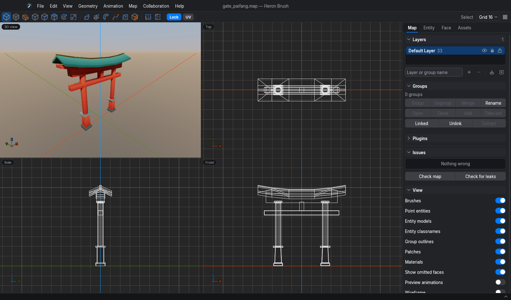

# Heron Brush

A level editor for brush-based (convex solid) geometry. It edits `.map` files and
exports levels and props to game engines.

**[Website](https://mojzisekjan.github.io/HeronBrush/) · [Try it in the browser](https://mojzisekjan.github.io/HeronBrush/editor/)**

## Status

Early alpha (0.1.0-alpha.2). Features, the interface, Heron's additions to the `.map`
format and the export output may change between versions.

## Platforms

Desktop builds for Linux, Windows and macOS. A web build runs in the browser and keeps
maps in browser storage or in local files. An Android build has touch input and a layout
for tablets. The interface and the offline manual are translated into 30 languages.

## Editing

- Shapes: cuboids, stairs, arches, cylinders, cones, spheroids, hollow spheres made of
  brushes, and 3D text.
- Vertex, edge and face editing; move, rotate, scale, shear, clip.
- Fillet: rounds selected edges with mitred, rounded, chamfered or setback corners.
- Join corner: joins two members at a mitred or rounded corner of the same thickness.
- Sweep faces along arcs, straight paths and S-bends; inset, bevel, hollow, merge,
  subtract and intersect.
- Arrays: copies in a row, a grid, a ring or a random scatter, optionally as linked
  duplicates of a group.
- Terrain and caves: brushes split into triangular or square columns, then shaped with
  a sculpt brush that raises, lowers, smooths and flattens, up or along the view.
- Patches, layers, groups and linked groups.
- A Blender-style keymap as an option.

## Materials

- Per-face colours and linear or radial gradients, without textures.
- Textures from folders, WAD files and PAK, ZIP and PK3 archives; PBR materials with
  normal maps.
- A UV editor.
- A 3D view with sun shadows, image-based lighting, ambient occlusion and a procedural
  sky.

## Entities and animation

- Entity definitions from FGD, DEF and ENT files, with model previews (MD2, MD3, OBJ,
  glTF).
- Game profiles for Quake, Quake 2, Quake 3, Half-Life, Daikatana, Hexen 2 and other
  Quake-lineage games (16 in all), plus your own.
- Compile and run profiles; map and leak checks.
- Keyframe animation of brush entities: clips on a timeline, triggered by buttons and
  sensors.

## Export

- Engines: Godot, Unity, Unreal Engine, Flax Engine, Stride, Defold, Cocos Creator,
  GDevelop, Bevy, three.js and raylib. Formats: glTF, GLB and OBJ.
- Exports carry collision, entities and their properties, animation, materials, water
  volumes, the sky and lightmap UVs; what each engine receives is listed in the
  [export contract](docs/engine-export-contract.md).
- Live links to Godot, Unity, Defold and Flax send unsaved edits to the open engine
  editor.
- A browser playtest of the current map.
- Maps are saved as plain-text `.map` files that Quake-lineage compilers read.

## Other

- An asset library of props.
- Collaborative editing over a local network or the internet.
- Render cameras that save PNG images; a separate 3D window.
- Plugins in a sandboxed scripting language.
- An MCP server for building and editing maps from scripts or AI agents.

[`demos/`](demos/README.md) has small games and levels made with the editor, each with
an engine project.

## Documentation

The Help menu opens the manual, whose sources are in `docs/manual/` (for example
[English](docs/manual/en.md)).

- [Map format](docs/map-format.md), [plugins](docs/plugins.md),
  [common entities](docs/common-entities.md)
- [Engine export contract](docs/engine-export-contract.md) and the
  [engine checks](examples/engine-checks/README.md)
- Live links: [Godot](docs/godot-live-link.md), [Unity](docs/unity-live-link.md),
  [Defold](docs/defold-live-link.md), [Flax](docs/flax-live-link.md)
- [Keyframe animation](docs/keyframe-animation.md),
  [render cameras](docs/render-camera.md)
- [Building from source](docs/building.md)

## Licence

GPL-3.0-or-later; see [LICENSE](LICENSE).

Heron Brush is a derivative work of [TrenchBroom](https://github.com/TrenchBroom/TrenchBroom)
by Kristian Duske and contributors, under the same licence. See [CREDITS.md](CREDITS.md)
for the credits and third-party licences.
