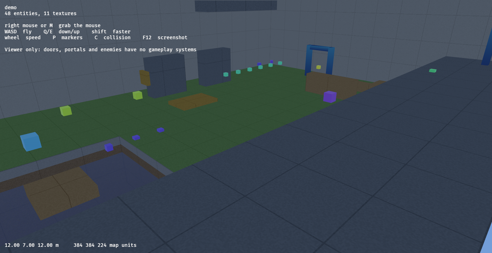

# Bevy FPS

A Bevy 0.19 sample that loads a level exported from Heron Brush: the engine-neutral JSON,
GLB meshes and textures. Avian 0.7 gives it rigid bodies, mesh and convex collision, and
sensors.



```sh
cargo run --manifest-path demos/bevy_fps/Cargo.toml
```

WASD walks, the right mouse button looks, Space jumps and Shift runs. `--fly` gives a free
camera (Q and E for down and up), `--at x,y,z` places it, P shows entity markers, C shows
collision and F12 saves a screenshot. Doors, portals and enemies are markers only: game
behaviour is the game's own.

## Edit and export

`maps/demo.map` uses the entities in `gamedata/fpskit.fgd`. With an editor build at
`target/debug/heron-brush`:

```sh
python3 demos/bevy_fps/export_demo.py
python3 demos/bevy_fps/verify_export.py
cargo run --manifest-path demos/bevy_fps/Cargo.toml -- --physics-check
cargo test --manifest-path demos/bevy_fps/Cargo.toml
```

`src/level.rs` loads the level and links every spawned entity to its source with
`SourceEntity`, so a game can attach its own components. `src/physics.rs` is the
optional Avian adapter. See the [export contract](../../docs/engine-export-contract.md).

Credits: the loader started from MIT code of the earlier tbx project (`LICENSE-TBX`);
textures and kit content are Kenney's (`LICENSE-KENNEY`).
