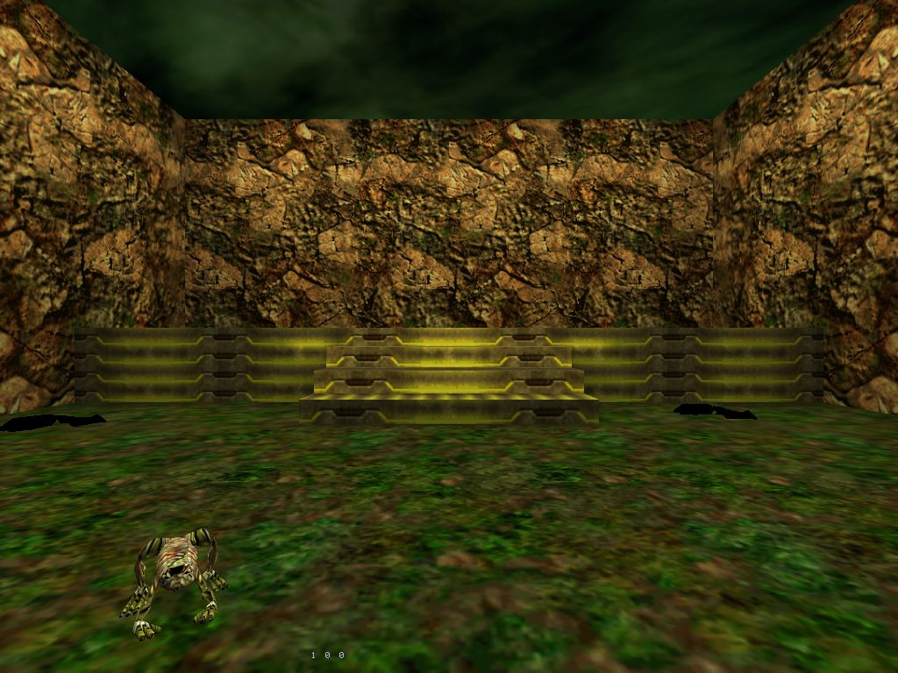

# Daikatana: Heron Marsh Gate

A small single-player level built in Heron Brush with the textures of the Daikatana
demo's first map, `e1m1`, and compiled with Ion Storm's tools from the Daikatana 1.3
project. A fortified hall and a courtyard open to the sky: a button on the hall's wall
opens the door between them, a trigger in the courtyard's doorway switches the
courtyard's lamps on and says so, froginators and protopods wait there, and steps lead
up to a platform where the exit loads the demo's first map.

- `heron_marsh.map` is the map as Heron Brush saves it (Valve 220).
  `heron_marsh_dk.map` is the same map exported in the Quake 2 face lines that
  Daikatana's `qbsp3` reads, which is what `build.sh` compiles.
- Every texture is in the demo's `data/pak1.pak`. Daikatana's `.wal` files carry no
  surface flags, so the sky lid and the two ceiling panels get theirs on the face:
  sky and light with a value of 300 on the lid, light with 3000 on the panels, each
  with Daikatana's light colour after the value.
- Worldspawn names `palette` `e1m1` and `episode` `1`, as the DK tools' readme asks.
- `build.sh` runs `qbsp3`, `qvis3` and `arghrad` and copies the bsp into the game's
  `data/maps` and the viewer's game folder. `build.sh --remake` runs `make_map.py`
  first, which builds the map again through Heron's MCP server.
- The Daikatana 1.3 engine does not start on the demo's data (it checks for the
  retail 1.2 paks), so the level was looked at in Yamagi Quake II Remaster, which
  reads Daikatana's paks and maps. `playtest.cfg` is for that viewer: it presses the
  button, walks through the door and the trigger and takes screenshots.

What to install and how to run it is in
[the game profile tests](../../docs/game-profile-tests.md#daikatana).
