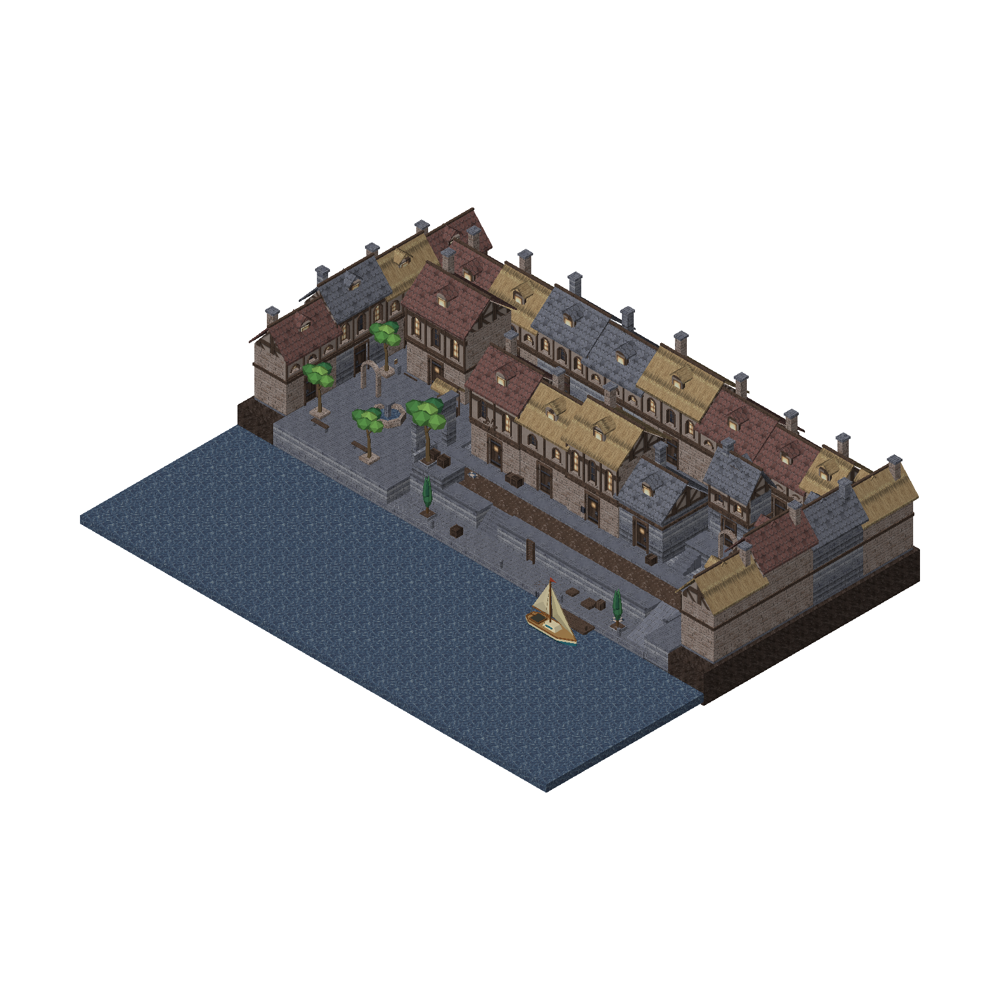

# Lantern Lane

An editable fantasy canal quarter with Kenney's Retro Textures Fantasy, laid out as a
walking tour of every FPS-kit entity: from a stepped quay through a stone arch to a
market square.



Open `lantern_lane.map` in Heron Brush; `lantern_lane.fgd` and the `textures` folder
beside it are all it needs, so the folder can be moved anywhere.

## Play

- `godot/project.godot` in Godot, F5: the full tour with gameplay.
- `play.html`: the exported three.js preview, geometry and collision only (its libraries
  load from a CDN).

WASD moves, the mouse looks, Space jumps, Shift runs, F uses and Escape pauses. Signs
along the route explain the stops:

1. Linked portals.
2. Doors: a floor trigger, a button, a use panel, a key and a locked door.
3. Movement: a lift, a shuttle, a bobbing boat, a ladder, a jump pad, a physics crate.
4. A checkpoint, collectibles that open a gate, positional sound.
5. An optional combat lane: a weapon, enemies, a barrel, a damage vent, particles.
6. Solid, walk-through and invisible collision; gradients and PBR paint.
7. The exit.

## Rebuild

```sh
python3 demos/lantern_lane/generate.py
python3 demos/lantern_lane/export_demo.py
godot --headless --path demos/lantern_lane/godot --script res://verify_showcase.gd
```

`generate.py` overwrites the map. `export_demo.py` exports through the editor's MCP
server to three.js, Godot and GLB; `--engines bevy unity` picks other targets.

Credits: textures by Kenney (CC0, `textures/kenney_fantasy/License.txt`); the Godot
runtime is Kenney's Starter Kit FPS as adapted by the earlier tbx project
(`godot/LICENSE-KENNEY.txt`, `godot/LICENSE-TBX.txt`, font licence in `godot/fonts`).
