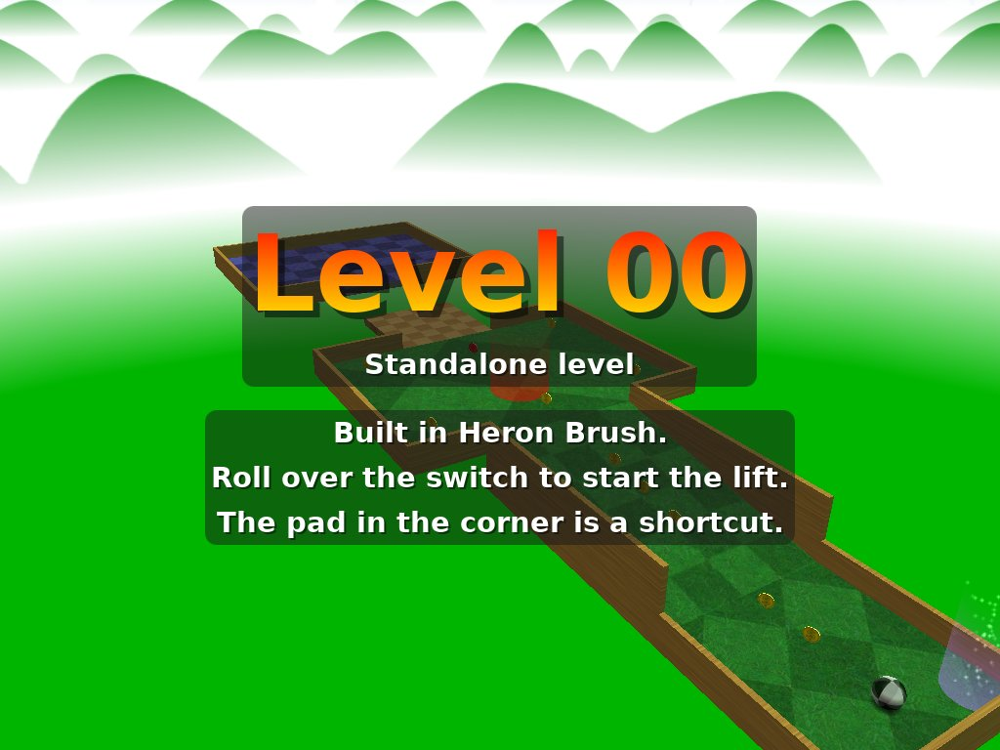

# Neverball: the lift

A small Neverball level built in Heron Brush and compiled with Neverball's `mapc`. A
start pad, a ramp up to a deck, a switch that starts a lift across a gap, and the goal
on the far deck. Ten coins open the goal, there are fifteen to find, and the clock gives
90 seconds. A teleporter in the start pad's corner is a shortcut onto the deck.

- `heron_lift.heron.map` is the map as Heron saves it (Valve 220).
- `heron_lift.map` is the same map exported in the Quake 3 dialect, which is what `mapc`
  reads. Its textures are Neverball's own `mtrl/...` materials. The saved map has the
  start pad's walls in a group and the goal deck on a layer; the export has them in the
  worldspawn, since Neverball 1.6's `mapc` loses the brushes of a `func_group`.
- `make_map.py` builds both again in Heron Brush, through the MCP server.
- `build.sh` compiles `heron_lift.map` to `heron_lift.sol` and installs it in Neverball's
  user folder, under `map-heron/`. `build.sh --remake` runs `make_map.py` first.
- `playtest.py` plays the level to the goal on a nested X display.

What to install and how to run it is in
[the game profile tests](../../docs/game-profile-tests.md#neverball).
