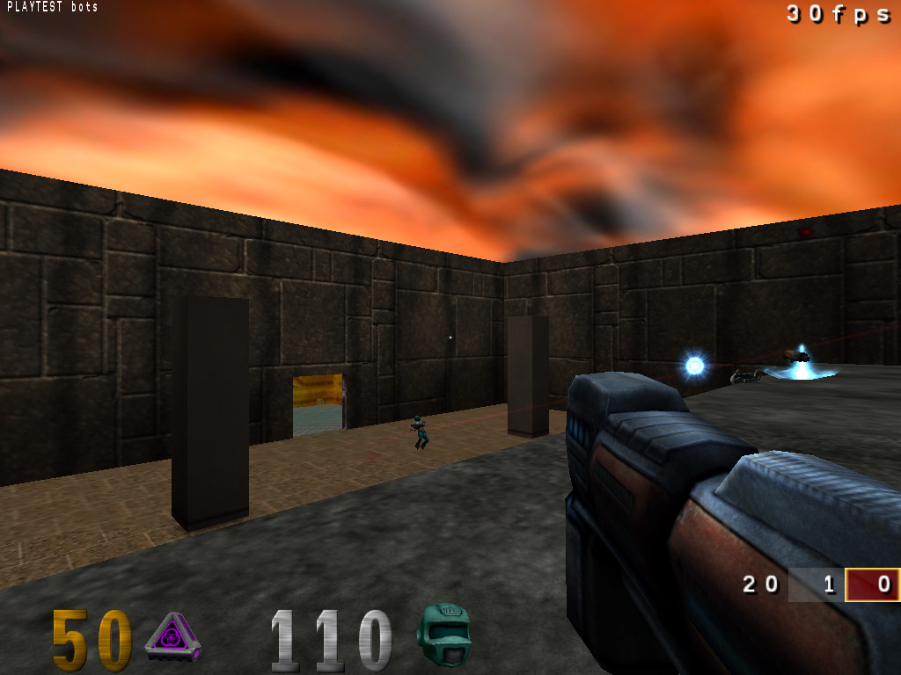

# OpenArena: the courtyard

A small deathmatch map built in Heron Brush for OpenArena, the free game on the Quake 3
engine, and compiled with q3map2. A courtyard open to a cloudy sky has a ledge along its
north wall: a jump pad in the yard throws the player up onto it, and stairs climb to it
in the east corner. A doorway in the south wall leads into a lit room whose teleporter
puts the player on the ledge. The rocket launcher waits on the ledge, the plasma gun in
the room, the shotgun and the railgun in the yard, with armour, health and ammunition
about, and five spawns.

- `heron_court.map` is the map as Heron Brush saves it (Valve 220 face lines, which
  q3map2 reads). `heron_court_brushdef.map` is the same map exported as Quake 3 brush
  primitives, the format GtkRadiant and NetRadiant write; both compile to the same
  geometry and texture coordinates.
- Every brush is `common/caulk` except the faces a player sees. The textures and shaders
  are OpenArena's own, from the pk3s in `baseoa`, and the entities come from
  `gamedata/Quake3/entities.ent`. The sky, `skies/q3dm0`, lights the yard with its
  `q3map_sun`; the room has light panels and point lights.
- `build.sh` runs q3map2's bsp, vis and light stages, builds the bots' `.aas` with
  mbspc and packs the bsp, the `.aas` and `heron_court.arena` into `heron_court.pk3` in
  `baseoa` under the game's home path. `--primitives` compiles the brush-primitive copy
  instead, and `--remake` builds the map again in Heron Brush first, through
  `make_map.py`.
- `playtest.cfg` rides the jump pad and the teleporter, adds three bots and takes a
  screenshot at each step: start the game with `+devmap heron_court +exec playtest.cfg`.

What to install and how to run it is in
[the game profile tests](../../docs/game-profile-tests.md#openarena-quake-3).
