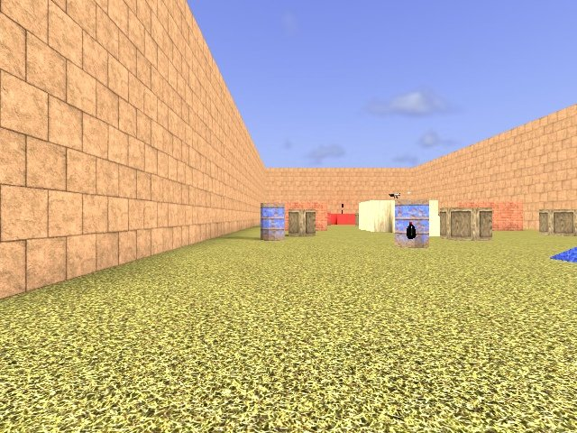

# Paintball 2: Twin Bases

A small capture-the-flag field built in Heron Brush for Digital Paint: Paintball 2 and
compiled with ericw-tools for Quake 2. Red's base is at the west end, blue's at the east:
each is a raised deck with the team's flag, the capture trigger around it, a ramp down to
the field and four team spawns. Barrels in the team colours, crates, two low walls and a
centre tower with a ramp from each side give cover on the way across. The ceiling is sky,
lit by a sun.

- `heron_bases.map` is the map. Its textures are the game's own, under
  `pball/textures/pball`, and its entities come from `gamedata/DigitalPaintball2/pball2.fgd`.
- `make_map.py` builds the map again in Heron Brush through the MCP server.
- `build.sh` runs `qbsp -q2bsp`, `vis` and `light` and copies the bsp into the game's
  `pball/maps` and `playtest.cfg` into `pball/configs`. `build.sh --remake` runs
  `make_map.py` first.
- `playtest.cfg` takes a screenshot at the spawn and after a few steps: start the game
  with `+map heron_bases +exec playtest.cfg`.

What to install and how to run it is in
[the game profile tests](../../docs/game-profile-tests.md#digital-paint-paintball-2).
