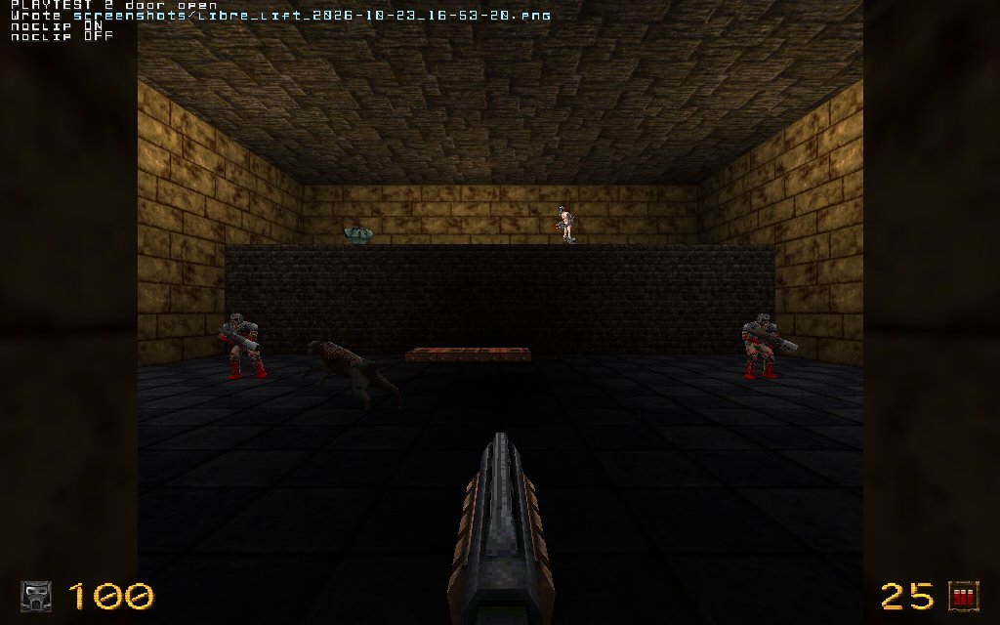

# Quake: the lift

A small Quake level built in Heron Brush for LibreQuake and compiled with ericw-tools.
Two rooms: a button opens the door between them, a trigger wakes an ambush and switches
its light on, a lift rises to a ledge, and the exit is on the ledge.

- `libre_lift.map` is the map. Its textures come from LibreQuake's mapping wads
  (`lq_medieval.wad`, `lq_tech.wad`, `lq_utility.wad`), which worldspawn names as
  `wads/...`, relative to the map.
- `build.sh` copies those wads into `wads/` (not committed), runs `qbsp`, `vis` and
  `light`, and installs the bsp as a LibreQuake mod called `heron`. `build.sh --remake`
  builds the map again in Heron Brush first, through `make_map.py`.
- `playtest.cfg` walks the level in the engine and takes a screenshot at each step.

What to install and how to run it is in
[the game profile tests](../../docs/game-profile-tests.md#quake).
