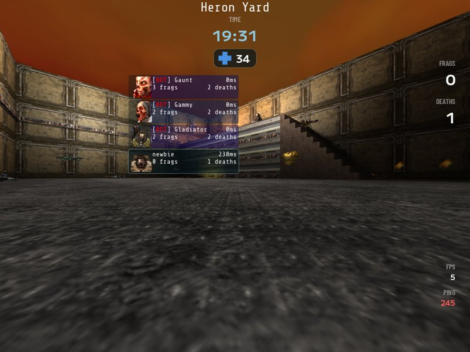

# Quetoo: Heron Yard

A small Quetoo deathmatch level built in Heron Brush and compiled with Quetoo's own
`quemap`. An open hall under the sky has a ledge along its north side, reached by
stairs from the east or by a jump pad; a doorway in the east wall leads to a side room
whose teleporter puts the player back on the ledge. Six spawns, the rocket launcher,
railgun, shotgun and hyperblaster with their ammo, health, two armours and a mega
health. Worldspawn's `min_clients` asks for four players, which the game makes up with
bots once the server's `sv_minClients` is `default`; its built-in value of 0 wins
otherwise, so `+set sv_minClients 4` is the simple way.

- `heron_yard.map` is the map as Heron Brush saves it. `quemap` reads Heron's face lines
  as they are; no export is needed.
- `heron_yard_playtest.map` is the same level with no bots and two spawns, one on the
  jump pad and one on the teleporter, for `playtest.py`.
- `make_map.py` builds both again in Heron Brush through its MCP server. The textures
  are Quetoo's own, from `default/textures` in the game's data, at the profile's UV
  scale of 0.25.
- `build.sh` compiles both maps with `quemap` and installs the bsp files, their
  manifests and `playtest.cfg` in Quetoo's user folder. `build.sh --remake` runs
  `make_map.py` first. Neither the compiler output nor the game data is committed.
- `playtest.py` respawns the player on the jump pad and on the teleporter and takes a
  screenshot each time with the player's origin showing; `playtest.cfg` binds the keys
  it presses.

What to install and how to run it is in
[the game profile tests](../../docs/game-profile-tests.md#quetoo).
