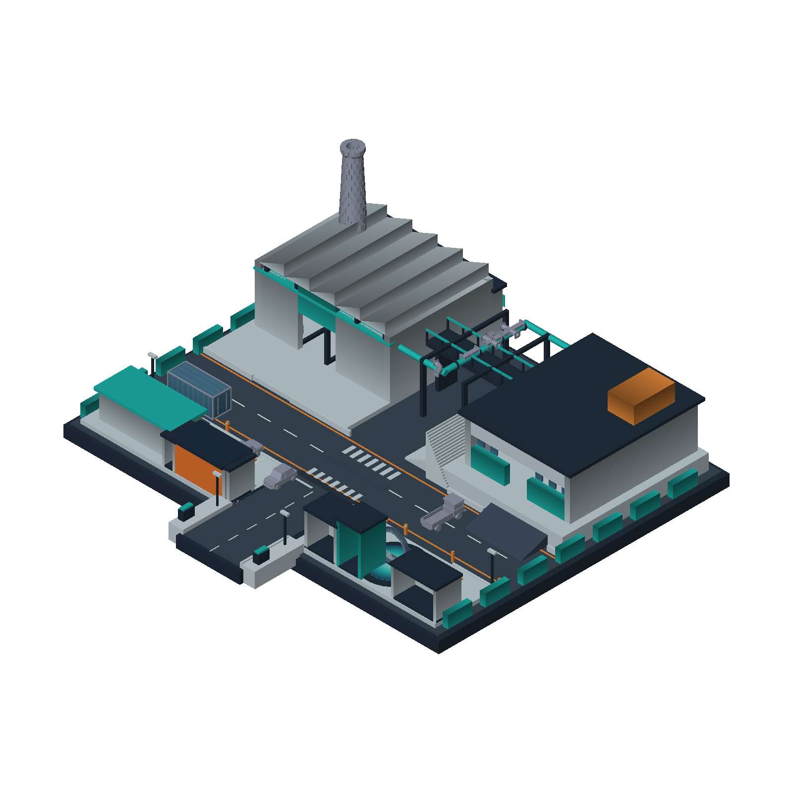

# Relay Yard

An industrial yard (a factory hall, a road with vehicles, pipes, a rotating portal ring)
built from the asset library's props, with their face paint kept.

Open `relay_yard.map` in Heron Brush. `generate.py` builds it again through the editor's
MCP server, from `architecture.map` and the library props; it overwrites the map.
